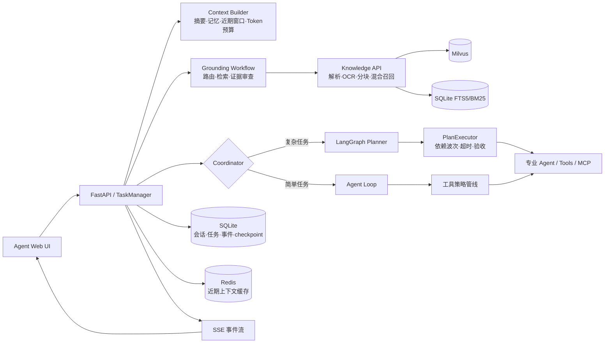

# 多智能体知识与任务协作平台

一个面向知识问答、文档检索、联网查询、服务导航和复杂任务执行的多智能体工作台。项目参考 **Harness Engineering** 思路，把模型调用放在可观测、可约束、可恢复的运行时中，围绕以下问题构建：

- 如何让主 Agent 把复杂目标拆成可执行步骤；
- 如何限制工具权限和高风险副作用；
- 如何让回答基于可追溯的检索证据；
- 如何在长上下文、SSE 断线和任务失败后保持状态一致。

## 核心能力

- **Coordinator + PlanExecutor**：主 Agent 负责理解目标和路由；LangGraph 承载计划状态；PlanExecutor 按依赖关系分波执行资料、技术、服务和工程步骤。
- **混合 RAG**：支持 Markdown、TXT、PDF、DOCX、XLSX 等文档解析，按需 OCR，父子分块，Milvus 向量检索与 SQLite FTS5/BM25 关键词检索融合，并支持可选 Cross-Encoder 重排。
- **证据约束**：生成前检查主体、型号、版本、日期、数值、适用条件和来源冲突；证据不足时澄清或拒答，并保留文件、页码和链接等来源信息。
- **分层记忆与上下文预算**：SQLite 保存完整会话，Redis 缓存近期上下文，摘要和结构化任务记忆保留较早信息；根据模型 profile 的上下文窗口和输出预算动态裁剪模型输入。
- **异步任务与 SSE**：后台任务与 SSE 订阅解耦，发送 `THINKING`、`PROCESS`、`ANSWER`、`FINISHED` 等结构化事件，支持事件回放、取消和符合条件的 checkpoint 恢复。
- **工具治理**：插件白名单、风险等级、用户确认、授权审计和生命周期 Hook 共同约束本地/MCP 工具；工程修改限制在授权工作区和管理员预设检查命令内。
- **工程评测与回归**：提供 Harness 场景契约、路由/回答离线评测、检索 Recall@K/HitRate@K/MRR 评估，以及 GitHub Actions 自动测试。

## 架构概览



一次请求的主要路径是：

```text
请求 Schema 校验
→ TaskManager 创建并持久化后台任务
→ 准备会话历史、摘要、长期记忆和附件
→ Grounding 路由、检索和证据审查
→ 普通 Agent Loop 或 LangGraph + PlanExecutor
→ 工具权限检查与执行
→ SQLite 记录事件/状态，SSE 推送前端
→ 主 Agent 汇总结果并归档回答
```

## 项目结构

```text
its_multi_agent/
├── backend/
│   ├── app/                  # 主应用：认证、会话、记忆、Agent、任务和 SSE
│   └── knowledge/            # 独立知识服务：解析、入库、混合检索和来源封装
├── front/
│   ├── agent_web_ui/         # 用户聊天与任务界面
│   └── knowlege_platform_ui/ # 知识库管理界面（目录名沿用现有拼写）
├── harness/                  # 服务级场景契约和评测适配器
├── Dockerfile.*              # 应用、知识服务和前端镜像
└── docker-compose.yml        # MySQL、Redis、Milvus、后端和前端
```

## 快速启动：Docker Compose

### 1. 准备环境

- Docker Desktop（启用 Compose）；
- 一个 OpenAI 兼容的模型服务，或 DeepSeek、SiliconFlow、阿里百炼等服务的 API 配置；
- Windows 用户建议使用 PowerShell，Linux/macOS 使用 bash。

### 2. 创建配置

在 `its_multi_agent` 目录复制配置模板：

```powershell
cd its_multi_agent
Copy-Item .env.example .env
```

至少修改以下配置：

```dotenv
SF_API_KEY=<provider-api-key>
AUTH_JWT_SECRET=随机生成的至少32位密钥
KNOWLEDGE_SERVICE_TOKEN=随机生成的至少32位密钥
MYSQL_PASSWORD=<mysql-password>
MYSQL_ROOT_PASSWORD=<mysql-root-password>
MINIO_ROOT_PASSWORD=<minio-password>
```

不要把 `.env`、API Key、模型凭据、数据库、日志或运行产物提交到 Git。`.env.example` 只用于展示配置项。

### 3. 启动服务

```powershell
docker compose --env-file .env up -d --build
```

首次构建和 Milvus 依赖启动可能需要较长时间。查看状态：

```powershell
docker compose ps
docker compose logs -f app-api knowledge-api
```

服务地址：

| 服务 | 地址 |
|---|---|
| Agent Web UI | http://127.0.0.1:5173/ |
| 主应用健康检查 | http://127.0.0.1:8000/readyz |
| 知识服务健康检查 | 容器内部 `http://knowledge-api:8001/healthz` |
| Milvus | `127.0.0.1:19530` |

停止服务：

```powershell
docker compose down
```

保留数据库和索引卷时不要加 `-v`。删除卷会清除本地 MySQL、Milvus、知识库和应用运行数据。

## 本地开发

后端和知识服务使用独立依赖环境。以下命令均从仓库根目录执行；将解释器路径替换为本地环境中的 Python 解释器：

```bash
python -m uvicorn its_multi_agent.backend.app.api.main:create_fast_api --factory --host 127.0.0.1 --port 8000
```

知识服务入口：

```bash
python -m uvicorn its_multi_agent.backend.knowledge.api.main:create_fast_app --factory --host 127.0.0.1 --port 8001
```

启动 Agent 前端：

```bash
npm --prefix its_multi_agent/front/agent_web_ui install
npm --prefix its_multi_agent/front/agent_web_ui run dev -- --host 127.0.0.1 --port 5173
```

知识库管理前端默认使用 3000 端口：

```bash
npm --prefix its_multi_agent/front/knowlege_platform_ui install
npm --prefix its_multi_agent/front/knowlege_platform_ui run dev -- --host 127.0.0.1 --port 3000
```

本地运行时，分别准备 `backend/app/.env` 和 `backend/knowledge/.env`，或通过环境变量指定配置。主应用的 `KNOWLEDGE_BASE_URL` 应指向本地知识服务端口。

## 数据与配置说明

- **会话**：SQLite 保存完整消息；模型输入使用摘要、近期消息和当前任务记忆。
- **近期上下文**：Redis 仅用于加速，失效时从 SQLite 回源。
- **长期记忆**：默认 SQLite，可通过 `MEMORY_BACKEND=milvus` 切换到独立的 Milvus 记忆集合；两者不是自动双写容灾。
- **知识库**：Milvus 保存向量检索数据，SQLite FTS5 保存词法索引和文档注册/任务状态。
- **任务**：SQLite 保存任务状态、SSE 事件和计划 checkpoint。
- **模型**：通过 `.env` 或 `MODEL_PROFILES_JSON` 配置 OpenAI 兼容服务；每个 profile 可指定上下文窗口和最大输出 token。

常用知识库配置：

```dotenv
PARENT_CHUNK_SIZE=2400
PARENT_CHUNK_OVERLAP=200
CHILD_CHUNK_SIZE=600
CHILD_CHUNK_OVERLAP=100
BM25_RETRIEVAL_ENABLED=true
OCR_ENABLED=true
CROSS_ENCODER_MODEL=
```

`CROSS_ENCODER_MODEL` 为空时不启用 Cross-Encoder 精排。真实模型、Milvus、OCR 和地图 MCP 联调需要配置对应服务，默认测试替身不能证明线上检索质量。

## 测试与评测

从仓库根目录执行应用测试：

```powershell
python -X utf8 -m unittest discover -s its_multi_agent/backend/app/tests
python -X utf8 -m unittest its_multi_agent.harness.test_harness
```

知识库测试：

```powershell
python -X utf8 -m unittest discover -s its_multi_agent/backend/knowledge/test
```

前端检查：

```powershell
npm --prefix .\its_multi_agent\front\agent_web_ui run check
npm --prefix .\its_multi_agent\front\knowlege_platform_ui run check
```

路由与回答评测支持 28 条合成场景和五类指标；检索评测支持 Recall@K、HitRate@K 和 MRR。评测指标中的引用 ID、关键词覆盖和来源类别是工程代理指标，仍需要人工语义审查，不能直接等同于真实生产准确率。

GitHub Actions 会在相关后端、Harness 或工作流文件变更时运行应用、Harness 和知识库测试，配置见 [.github/workflows/app-harness.yml](.github/workflows/app-harness.yml)。

## 安全边界与已知限制

- 模型只能提出工具调用，工具策略层负责白名单、确认、风险和副作用检查；工程修改还需要授权工作区和预设检查命令。
- 复杂任务失败后支持基于 checkpoint 的显式恢复；包含编码或外部服务副作用的未完成步骤不会自动重放。
- 项目没有通用的 Saga 自动回滚机制；通过幂等操作 ID、文件版本校验、工作区锁和原子写入降低重复副作用。
- Milvus 与 SQLite 没有跨库 ACID 事务，索引部分失败时依赖补偿和后续对账。
- 当前配置适合本地演示和工程研究；部署到生产环境前还应补充密钥管理、资源配额、网络隔离、用户/项目级 ACL、压测和真实检索标注评测。

## 进一步文档

- [Harness 评测说明](its_multi_agent/harness/README.md)
- [知识库服务说明](its_multi_agent/backend/knowledge/README.md)
- [复杂任务执行](its_multi_agent/docs/complex-task-execution.md)
- [文档提取与入库](its_multi_agent/docs/document-extraction.md)
- [LangGraph 编排](its_multi_agent/docs/langgraph-orchestration.md)

## 许可证

当前仓库未声明开源许可证。发布前请补充 `LICENSE` 文件，并确认知识库样例文档、第三方模型、地图服务和抓取内容具备公开使用权限。
